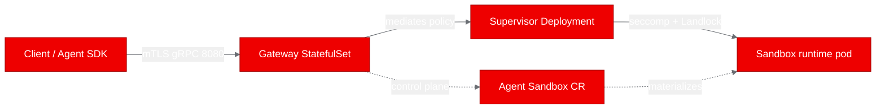
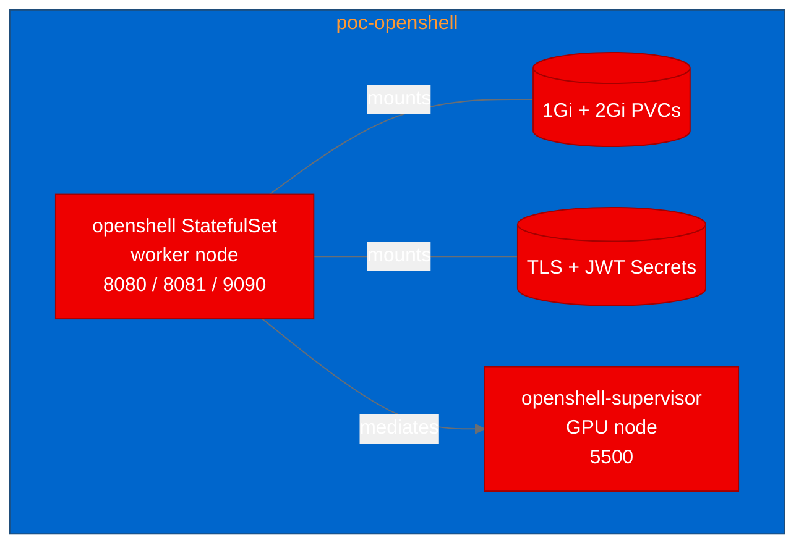
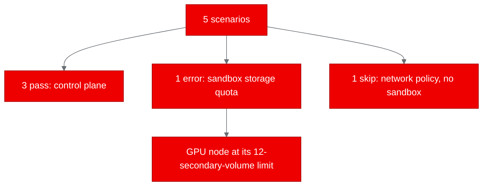

## What is OpenShell?

Autonomous agents run code you did not write, on nodes you share with everything else on the cluster. OpenShell, from NVIDIA, is designed to isolate those agents. This PoC built its runtime images and tested control-plane access on a [Red Hat OpenShift](https://www.redhat.com/en/technologies/cloud-computing/openshift) cluster.

It doesn't trust an agent process to behave. Instead it instruments the Linux kernel: Landlock for filesystem policy, nested seccomp user-notification (a mechanism that sends selected system calls to a supervisor for policy decisions) for syscall and network mediation, and SO_BINDTODEVICE (which pins each socket to a single network device). A Rust gateway fronts the control plane over gRPC, a trusted supervisor mediates each sandbox's traffic, and a workload-side sandbox runtime owns the agent's process tree. The project includes z3-based policy verification; this PoC did not test that mechanism.

The short version: it's a hard boundary you can put around an agent, and it ships with its own Helm chart for Kubernetes. If you want the full platform context, the [OpenShift AI documentation](https://docs.redhat.com/) is a good place to start.

## Why it matters for Red Hat OpenShift

OpenShift AI is where autonomous agent workloads increasingly run, and those workloads need a boundary that respects the platform rather than fighting it. OpenShell deploys through the Agent Sandbox controller and a standard Helm chart, targets the restricted-v2 SCC (Security Context Constraint), and needs no privileged SCC. That makes it a natural fit alongside the rest of an OpenShift AI estate: the agents stay contained, and the platform keeps its usual RBAC (role-based access control) and SCC story.

We wanted to test the isolation claims on a live cluster, not just read them in the docs. The result is mixed, and we'll show you exactly where it stopped.

## The components we chose to deploy

The repository is a Rust workspace of more than 40 crates. For this proof of concept we treated 3 of them as deployable components: the gateway, the supervisor, and the sandbox runtime. The project already ships a Helm chart and a Python SDK (software development kit), which is exactly what we leaned on instead of writing our own manifests.

**Figure 1. OpenShell component flow. The dashed edges are control-plane objects, not runtime hops.**

One distinction matters for what comes next: the gateway and the supervisor are the only workloads the Helm chart deploys. The sandbox runtime isn't a chart workload. It is materialized per sandbox by the Agent Sandbox controller the moment a sandbox is created, which is why a healthy gateway doesn't by itself prove the sandbox path.

## Containerizing for OpenShift

Each component builds from the pinned source in a multi-stage UBI9 image. The builder stage installs the Rust toolchain plus the C and C++ compilers the vendored dependencies need, and the runtime stage is ubi9/ubi-minimal with the binary copied in and the final user set to 1001. Group permissions and SCC-compatible Helm settings allowed OpenShift to assign a namespace UID (user identifier).

This part took 2 retries, and both were worth writing down:

- UBI9 does not ship a standalone libclang package; it is provided by clang-devel. The first build failed at the package step until we used the right name.
- The gateway vendors z3 and compiles it with CMake. The first working toolchain picked GCC 11, which lacks the C++20 std::format support the code needs. Selecting the newer compiler toolchain fixed the build.

## Deploying to the cluster

We installed the project's own Helm chart into a dedicated namespace, poc-openshell, with cluster-scoped RBAC turned off because a matching ClusterRole was already prepared out of band. The chart renders the gateway as a StatefulSet (it keeps a SQLite volume) and the supervisor as a Deployment. Both came up 1/1 Ready.

2 things deserve credit where it's due. Neither was the software healing itself:

- The supervisor's PodDisruptionBudget needed a namespace-scoped Role and RoleBinding that the operator provisioned, followed by a Helm upgrade to revision 2. That restored the budget while preserving the existing TLS (Transport Layer Security) material.
- The gateway volume originally landed on the GPU (graphics processing unit) node, which had already hit the cloud provider's 12-secondary-volume limit. The operator pinned the gateway to a worker node in the same zone with a nodeSelector, and that placement is now committed in the source so it reproduces.

**Figure 2. poc-openshell topology after the operator-assisted placement.**

## Running the proof-of-concept tests

We defined 5 scenarios and ran them against the live deployment. Here is the honest result: 3 passed, 1 errored, and 1 was skipped.

| Scenario | Result | What actually happened |
|---|---|---|
| gateway-health | Pass | HTTP 200, gateway reports healthy |
| gateway-metrics | Pass | HTTP 200, Prometheus exposition format |
| gateway-api | Pass | gRPC Health and sandbox listing over mTLS |
| sandbox-lifecycle | Error | Pod stuck at Init 0/2; 240s wait timed out |
| network-policy-enforcement | Skip | No ready sandbox to run against |

The 3 passing scenarios are a real result: the health and metrics endpoints answered HTTP (HyperText Transfer Protocol) 200, the control plane answers over mTLS (mutual TLS), and the gRPC API (application programming interface) lists sandboxes. We're comfortable saying the gateway works on OpenShift. If you run agent workloads, that control plane is the part to look at first, and the [AutoPoC project](https://www.redhat.com/en) is the fastest way to try it.

The captured sandbox error had direct storage-attachment evidence. The sandbox pod's persistent volume was bound, but the volume attachment never completed. The cloud provider's CSI (Container Storage Interface) driver reported an over-quota condition, 12 secondary volumes, on the GPU node, and the pod emitted FailedAttachVolume for the entire 240-second wait. The captured attempt was blocked by storage attachment; remaining software paths were untested. Because the sandbox never became ready, the network-policy scenario had nothing to attach to, so we recorded it as a skip rather than pretending it ran.

**Figure 3. The PoC outcome in one view.**

## What we learned

The control plane is solid on OpenShift, and the deployment story is genuinely first-class: a real Helm chart, the Agent Sandbox controller, and no privileged SCC. That's the part we would take to a team tomorrow.

The isolation story is where we stopped and looked. We're not claiming the kernel-mediated network and filesystem boundaries are proven, because the sandbox never got far enough to exercise them. A pod that's Ready isn't the same thing as a sandbox that is isolated, and we would rather say that plainly than dress it up.

We also learned 2 practical lessons. First, UBI packaging has real edges: a missing libclang and a compiler that is too old for the required C++20 headers both cost us a build cycle. Second, a proof of concept runs on a real cluster with real quotas, and a 12-volume limit on a GPU node is exactly the kind of thing you only find by trying.

On the security side, one caveat matters. The gateway requires an mTLS client certificate, but it also promotes a certificate-verified caller to a local-development principal. That's the project's own posture for its OpenShift end-to-end tests, which was the configuration used for this PoC. It isn't the same as production identity, and we didn't test production OIDC (OpenID Connect) here.

## Try it yourself

If you run OpenShift AI and you want a hard boundary around your agent workloads, OpenShell is worth a look. The AutoPoC pipeline built the images, deployed the chart, and ran the tests in one pass, and it told us exactly where the platform and the workload met.

The source, the UBI Dockerfiles, and the Helm values all live in the [openshell autopoc branch](https://github.com/aicatalyst-team/openshell/tree/autopoc) if you want to see exactly what was built. Try deploying your own project with AutoPoC, and bring a workload that's a little ambitious. The failures are usually the most useful part.
