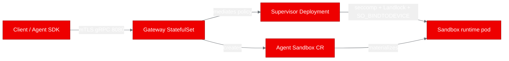
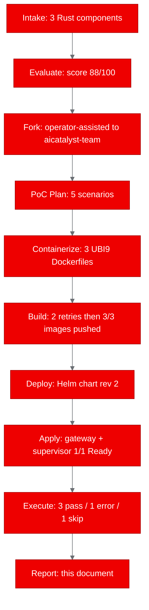
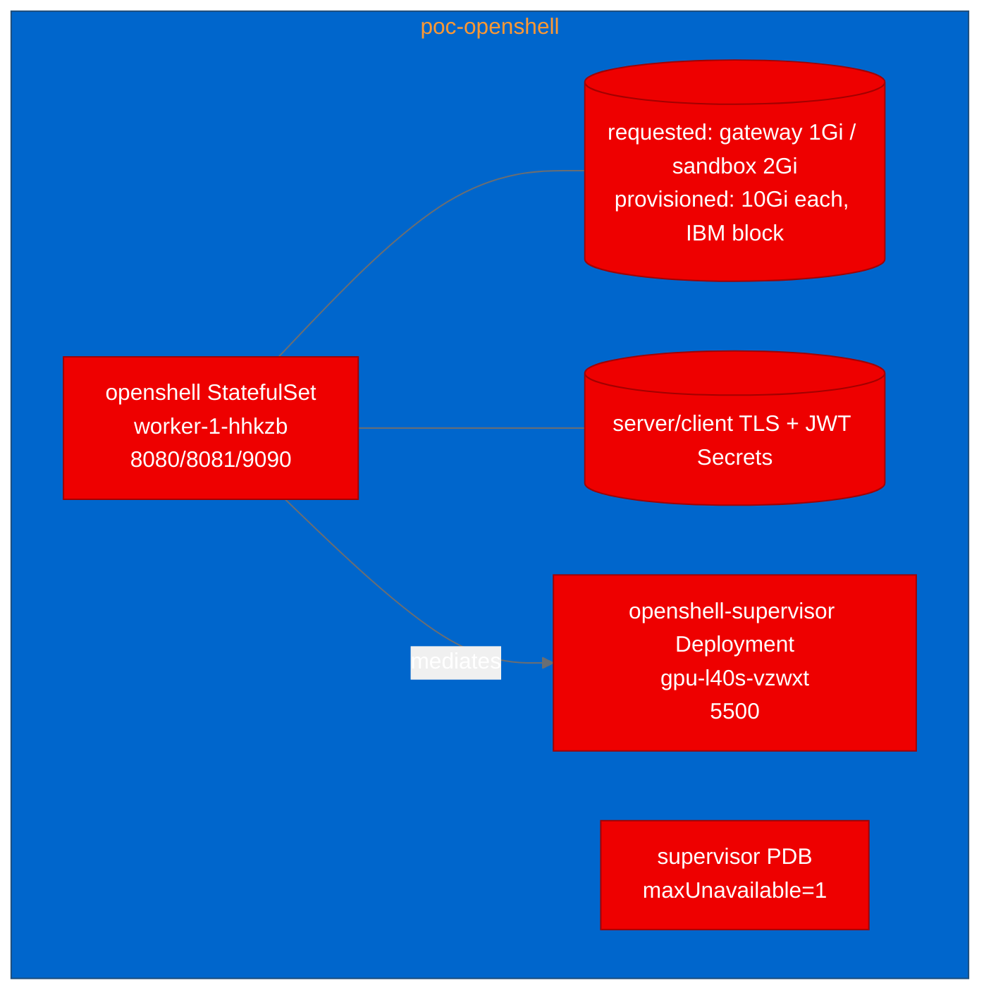

# OpenShell PoC Report

## 1. Executive Summary

This PoC evaluated **OpenShell** (NVIDIA), a kernel-enforced secure runtime for fleets of autonomous AI agents, and built its three Rust components (gateway, supervisor, sandbox runtime) for OpenShift 4.21.8. All three UBI9 images were built from pinned source `f4a6137` plus the documented generated container/compiler changes and pushed to Quay. The control-plane components were deployed via the project's Helm chart into namespace `poc-openshell`; the gateway (StatefulSet) and supervisor (Deployment) both reached **1/1 Ready**. Of five validation scenarios, **three passed** (gateway health, gateway metrics, and the mTLS gRPC control-plane API), **one errored** (sandbox lifecycle, blocked by a real IBM-CSI storage quota on the GPU node), and **one was skipped** (network-policy enforcement, dependent on the unavailable sandbox). The limited health, metrics and authenticated API smoke checks passed; the sandbox isolation scenarios could not complete due to a platform storage limit, so the PoC demonstrates a working, authenticated gateway but does not yet certify kernel-level isolation.

## 2. Project Analysis

- **Repository:** `https://github.com/NVIDIA/OpenShell`
- **Pinned source commit:** `f4a6137513b777c9b362be54baf388f7d45398aa`
- **Fork:** `https://github.com/aicatalyst-team/openshell` (branch `autopoc`, HEAD `c276cf08a72de1ee5b1bdc07a566bf4afcf18611`)
- **Classification:** infrastructure (kernel-mediated sandbox runtime + gRPC control plane)

The source project is designed to instrument the Linux kernel (Landlock + nested seccomp user-notification + `SO_BINDTODEVICE` + task-memory access) to enforce per-sandbox file, syscall, and network policy, and uses formal verification (z3) to review policy changes. The control plane is a Rust gateway (gRPC/HTTP on 8080, health on 8081, metrics on 9090); a trusted supervisor mediates each sandbox's network/DNS; and a trusted workload-side sandbox runtime binary starts and owns the agent process tree. On Kubernetes it deploys via its own Helm chart using the Agent Sandbox controller and requires a CNI that enforces NetworkPolicy.

| Component | Language | Build System | ML Workload | Port |
|---|---|---|---|---|
| gateway | rust | cargo | no | 8080 / 8081 / 9090 |
| supervisor | rust | cargo | no | 5500 (internal) |
| sandbox | rust | cargo | no | (workload-side runtime) |

## 3. PoC Objectives

- Build all three source-built Rust components from the pinned commit into UBI9 images and push them to Quay.
- Deploy the project's own Helm chart into `poc-openshell` using the preinstalled gateway ServiceAccount binding, with `rbac.clusterScoped.create=false`, restricted-v2 SCC compatibility, and no privileged SCC.
- Validate the gateway control plane: HTTP health, Prometheus metrics, and the mTLS gRPC API (Health + sandbox listing) via the project's Python SDK.
- Validate the full sandbox lifecycle through the Agent Sandbox controller: create, wait-ready, exec, verify CR + pod, delete.
- Validate actual runtime isolation: an in-policy egress destination succeeds, an out-of-policy destination is blocked by the kernel-mediated boundary, and the outer-fence NetworkPolicy is present.

Relevant to OpenShift AI because autonomous agent workloads (TrustyAI guardrails, MCP credential connectivity) need a hard execution boundary; Potential suitability for agent workloads is an architectural inference; this PoC did not validate an OpenShift AI integration or production security.

## 4. Pipeline Execution

- **Intake:** Discovered three cargo-built Rust binaries (gateway, supervisor, sandbox), an existing Helm chart, and a Python SDK under `python/`.
- **Evaluate:** Scored **88/100** (direct relationship to agentic-ai / trustworthy-ai / mcp strategy areas).
- **Fork:** The worker GitHub token returned HTTP 403 on the destination org, so the operator created and protected the `aicatalyst-team/openshell` fork and pushed the pinned source to `autopoc`. That earlier worker exceeded repository scope with failed write-access probes on unrelated repositories; it was stopped, and no successful probe write was reported. The user then provided a dedicated token restricted to this fork. Actual source and artifact-branch pushes verified its required access; Administration API permission remained unnecessary because the operator had already protected main.
- **PoC Plan:** Infrastructure type; 5 scenarios; 1Gi gateway + 2Gi per-sandbox PVCs on `ibmc-vpc-block-10iops-tier`; no GPU.
- **Containerize:** Three UBI9 multi-stage Dockerfiles (`deploy/docker/Dockerfile.{gateway,supervisor,sandbox}.ubi`), final `USER 1001`.
- **Build:** Two retries then success. Build 1 failed on UBI9 packaging (no `libclang` standalone, no musl packages) — fixed by using `clang-devel` and a bundled `musl.cc` cross toolchain. Build 2 failed compiling vendored z3 because CMake chose GCC 11 without C++20 `std::format`; the operator source fix selected GCC Toolset 15. Sandbox and supervisor build 2 succeeded; gateway build 3 succeeded after the compiler correction. All three images were pushed to Quay.
- **Deploy:** The project's own Helm chart, release `openshell`. See Section 6 for the operator-assisted placement and PDB recovery.
- **Apply:** Gateway StatefulSet and supervisor Deployment both 1/1 Ready.
- **PoC Execute:** Three captured executions against the live deployment; the final captured execution is the authoritative result (Section 5).

## 5. Test Results

Authoritative results are from the **final captured execution** `582bd9f07b82457885a7cde9c34b128d` (started 15:56:01, finished 16:00:05 UTC). Two earlier executions are retained as history only.

| Scenario | Status | Duration | Details |
|---|---|---|---|
| gateway-health | PASS | 0.014s | HTTP 200, status healthy (pod-level 8081) |
| gateway-metrics | PASS | 0.008s | HTTP 200, Prometheus text exposition on 9090 |
| gateway-api | PASS | 0.267s | gRPC Health RPC healthy; 1 sandbox listed over mTLS |
| sandbox-lifecycle | ERROR | 241s | `wait_ready` timed out at 240s; pod stuck `Init:0/2` |
| network-policy-enforcement | SKIP | ~0s | Skipped: sandbox from scenario 4 unavailable |

**Totals: 3 pass, 0 fail, 1 error, 1 skip, 0 incomplete.**

### sandbox-lifecycle (error) — direct storage evidence

The final captured execution hit a **real storage attachment failure**, not an SDK or cold-start defect. The sandbox PVC `pvc-c017cd35-f2b8-42d1-b521-bd1e81255ae9` was `Bound`, but its `VolumeAttachment` remained `attached=false`. IBM VPC CSI logs at **15:56:12, 15:56:23, 15:56:44 and 15:57:25 UTC** returned `over_quota` (maximum 12 secondary volumes) for volume `r018-ab0d7668-c45a-49f2-9dea-2a111327645d` on the GPU node `ocp-gb-xz56l-gpu-l40s-vzwxt`. The pod emitted `FailedAttachVolume` events and stayed `Init:0/2` for the full 240s wait. This direct evidence supersedes any speculative theory that an absent Agent Sandbox `status.phase` indicates an SDK readiness bug; a later diagnostic pod that reached Ready does not erase the captured failure. The operator stopped further unrecorded sandbox diagnostics after this third captured execution.

### network-policy-enforcement (skip)

Skipped because the sandbox from scenario 4 never became ready. A **real-reachable negative control** (a documented, externally-reachable host that is out-of-policy) was added to `poc_test.py` to disambiguate the doc-address denial, but it was **not exercised** in the final captured execution. No claim of network/CNI enforcement is made from this run.

### History — earlier executions (preserved, not the final result)

- `a7d99667` (order 0, 15:49): `gateway-api` and `sandbox-lifecycle` errored with `'str' object has no attribute 'read_bytes'` — the SDK `TlsConfig` expects `Path` objects, not strings. Fixed by source commit `5e2d868` (pass `pathlib.Path` to `TlsConfig`).
- `1cb27ad5` (order 1, 15:51): reached the marker `exec` but failed the harness's Agent Sandbox CR lookup (the CR is named `<workspace>--<name>`). Preserved as history, **not** a passing final lifecycle case. Fixed by source commit `c276cf0` (resolve the CR by its real name/selector; no leak on lifecycle failure).

## 6. Infrastructure Deployed

- **Cluster:** OpenShift 4.21.8 with OVNKubernetes configured. This run did not exercise or establish actual NetworkPolicy enforcement.
- **Namespace:** `poc-openshell` (SCC UID range 1001650000/10000, MCS `s0:c41,c5`).
- **Helm release:** `openshell`, **revision 2**, from `deploy/helm/openshell` with `kubernetes/helm-values.yaml`.

| Resource | Kind | Name | Node | Status |
|---|---|---|---|---|
| gateway | StatefulSet | `openshell` | `ocp-gb-xz56l-worker-1-hhkzb` | 1/1 Ready |
| supervisor | Deployment | `openshell-supervisor` | `ocp-gb-xz56l-gpu-l40s-vzwxt` | 1/1 Ready |
| supervisor PDB | PodDisruptionBudget | `openshell-supervisor` | — | maxUnavailable=1 |
| server/client TLS + JWT | Secret | `openshell-*-tls` | — | created by pre-install `pkiInitJob` |

**Images (exact digests):**

| Component | Image | Digest |
|---|---|---|
| gateway | `quay.io/aicatalyst/openshell-gateway:f4a6137` | `sha256:6ae7ed04496c84faf68eeca9daa36a9164398c823e193e15d08f164840b4d576` |
| supervisor | `quay.io/aicatalyst/openshell-supervisor:f4a6137` | `sha256:c9c177e7edcd1c23da60eab958109ddfb631e37f9adfbd4ee614de062a89dc96` |
| sandbox | `quay.io/aicatalyst/openshell-sandbox:f4a6137` | `sha256:b8bd0d75926bbf006f90f2873e9c1d558a31ff80eb989dfe0a0c457cef68f391` |

**Internal services (in-cluster FQDNs, no external Route):** `openshell.poc-openshell.svc.cluster.local` (8080/gRPC, 9090/metrics), `openshell-peer.poc-openshell.svc.cluster.local` (8080), `openshell-supervisor.poc-openshell.svc.cluster.local` (5500).

### Operator-assisted recovery (not spontaneous)

Two platform conditions required operator assistance, and both are recorded as such:

1. **PodDisruptionBudget.** The worker initially disabled the single-replica `maxUnavailable=1` supervisor PDB because it lacked `policy/poddisruptionbudgets` and could not self-escalate. The operator then provisioned a **namespace-only** Role/RoleBinding `autopoc-openshell-helm` granting the worker PDB access and ran `helm upgrade` to **revision 2 with `--no-hooks`**, restoring the PDB while **preserving the existing certificates** and healthy pods. A RoleBinding's ordering cannot bypass the RBAC escalation guard; the grant had to be applied out-of-band first.
2. **Gateway storage quota.** The gateway volume originally landed on the GPU node, which had already hit IBM's **12-secondary-volume** quota. The operator pinned the gateway to `ocp-gb-xz56l-worker-1-hhkzb` (a worker in the same zone with storage headroom) via a reproducible `nodeSelector`, committed in source commit `a606f758c`. This is operator assistance, not a spontaneous CSI recovery.

No privileged SCC or cluster-admin grant was made. Existing shared Secrets and CronJobs were unchanged; a separate run-specific GitHub credential Secret was introduced.

Actual IBM PVC capacity was 10Gi per claim, despite the smaller requested values.

## 7. Recommendations

- **Production readiness:** Not established. Five limited checks on a single OpenShift 4.21.8 cluster validate the control plane; they do not certify security, load/HA, or complete Kubernetes portability.
- **Sandbox isolation:** Re-run the sandbox-lifecycle and network-policy scenarios on a node with storage headroom (or a larger secondary-volume quota) to exercise the kernel-mediated boundary, including the added real-reachable negative control.
- **Authentication:** mTLS client credentials are required, but `allow_unauthenticated_users` promotes a certificate-verified caller to the local-dev principal (the project's own OpenShift e2e posture). Production OIDC was **not** tested. A pod being Ready is not, by itself, isolation validation.
- **Next steps:** (1) qualify sandbox readiness and egress enforcement on adequate storage; (2) test production OIDC; (3) load/failover testing of the supervisor pool; (4) confirm NetworkPolicy enforcement under the target CNI.

## 8. Open Data Hub / OpenShift AI Considerations

- OpenShell complements ODH by providing a hard execution boundary for agent workloads that ODH orchestrates; it does not replace KServe/ModelMesh inference serving.
- Its first-class Helm + Agent Sandbox CRD path maps cleanly onto ODH-managed namespaces; the preinstalled `autopoc-openshell-runtime` ClusterRole (bound to SA `openshell`) provides explicitly scoped cluster capabilities (node/runtime/priority reads, token review and a named namespace read), while the `autopoc-openshell-validation` Role grants namespace-specific validation access. The runner also has pre-existing broader PoC grants; this run does not establish that all worker access is namespace-scoped.
- Recommended ODH integration: run agent workloads inside OpenShell sandboxes, route their egress through the supervisor, and surface gateway metrics (9090) into the ODH monitoring stack.

## 9. Appendix

- **Canonical report:** this file (staged pre-link copy); published as an immutable `report` revision on `autopoc-artifacts`.
- **Plan:** `runs/<run>/plan/...` (poc-plan.md, published).
- **Evaluation:** `runs/<run>/evaluation/...` (published).
- **Tests:** current `poc_test.py` (with the real-reachable negative control), published as a `tests` revision. Earlier harness versions remain available through their source commits; no separate `.orig` file was verified.
- **Original evidence:** three captured executions and 15 recorded attempts in `attempt-index.json` and `executions/`; collected into a sanitized evidence bundle (see the independent `evidence` block).
- **Operator observations:** `poc_execute.operator_observations` and `operator-deployment-recovery.md`.
- **Provenance:** run `a189bdf54ac849778a8ed7b228db599f`; source `f4a6137`; source branch `autopoc` HEAD `c276cf08a` (includes compiler fix `fd44e465`, operator deployment fix `a606f758c`, and test-harness fix `c276cf0`).
- **Not published:** private TLS keys under `staging/client-tls` and raw diagnostics are intentionally excluded from all public artifacts.
