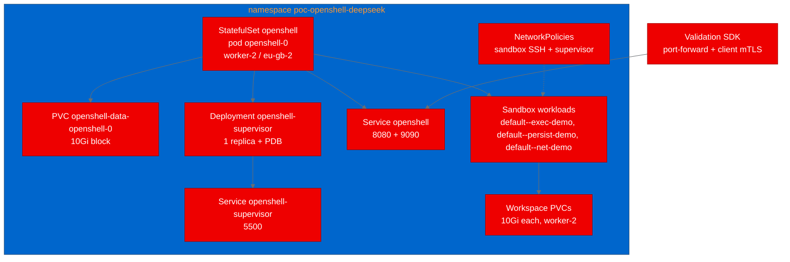

# PoC Report: NVIDIA OpenShell on OpenShift

- Run ID: `ac05c639abd848998db29ce2352d9a0f`
- Source: `https://github.com/NVIDIA/OpenShell`
- Pinned revision: `f4a6137513b777c9b362be54baf388f7d45398aa`
- Namespace: `poc-openshell-deepseek`
- Helm release: `openshell`
- Orchestration model: `enmaas/rits/deepseek-ai/DeepSeek-V4.1-Flash-1017` through Red Hat EnMaaS
- Report date: 2026-11-04

## 1. Executive Summary

This PoC evaluated NVIDIA OpenShell, a policy-governed runtime for autonomous AI
agents, on OpenShift. The gateway, shared supervisor, and sandbox runtime were
built from the exact pinned source as three new UBI-based images and deployed
with the project's Helm chart under the OpenShift `restricted-v2` profile.

All five planned validation scenarios passed in the final original execution:
gateway health, genuine sandbox process execution, workspace persistence across
a stop/start, policy-approved network access, and policy denial of a second
reachable destination. The denial is demonstrated by OpenShell supervisor OCSF
evidence, not by object presence alone. Production authentication, HA, load,
CNI enforcement, and portability were not established and are not claimed.

## 2. Project Analysis

OpenShell gives autonomous agents controlled access to files, processes, and
networks. A gateway control plane provisions sandboxes; a trusted supervisor
mediates policy; the sandbox runtime applies kernel-level isolation. On
Kubernetes, the gateway's compute driver creates an Agent Sandbox `Sandbox`, a
supervisor Pod, a workload Pod, a boundary Service, NetworkPolicies, and a
workspace PVC.

| Component | Language | Build system | ML workload | Port |
|---|---|---|---|---|
| openshell-gateway | Rust | Cargo | No | 8080 API, 8081 health, 9090 metrics |
| openshell-supervisor | Rust | Cargo | No | 5500 boundary, 5501 health |
| openshell-sandbox | Rust | Cargo | No | none (runtime) |
| openshell-python-sdk | Python | setuptools | No | n/a (client) |

- PoC type: `infrastructure` (agent runtime/control plane with SDK validation).
- Key technologies: Rust 2024 workspace (41 crates), `agents.x-k8s.io` Sandbox
  CRD, Helm, mTLS, OpenShell policy proxy, Python SDK.
- ODH relevance: governed agent execution maps to Agentic AI plus Management,
  Observability & Security capabilities such as agent runtime, tool calling,
  MCP, guardrails, observability, and supply-chain controls.

## 3. PoC Objectives

1. Build all three trusted runtime images from the pinned source with UBI base
   images, without using previous or prebuilt core images.
2. Deploy the gateway and shared supervisor with the operator-prepared
   ServiceAccount/RBAC, `restricted-v2`, non-root execution, and block storage.
3. Validate real behaviour rather than only a health probe: process execution,
   workspace persistence, and policy allow/deny against a reachable control.
4. Preserve honest scope boundaries: separate application policy mediation from
   CNI enforcement, and do not infer production security, OIDC, HA, or load
   readiness from smoke checks.

## 4. Pipeline Execution


| Phase | Result | Detail |
|---|---|---|
| 1. Intake | Complete | Pinned source cloned; four components identified; Helm/CRD prerequisites inspected. |
| 2. Evaluate | Complete | Impact 90/100; feasibility 57/80; relationship `enriches-existing-capability`. |
| 3. Fork | Complete | Operator-verified fork and write branch adopted at the pinned SHA; no repository creation or protection changes. |
| 4. PoC Plan | Complete | Five scenarios; namespace, node, storage, RBAC, and shared-supervisor topology defined. |
| 5. Containerize | Complete | Three UBI Dockerfiles from the operator reference, provenance recorded. |
| 6. Build | Complete | Three binary BuildConfigs; all first-attempt successes; new tag only. |
| 7. Deploy | Complete | Helm values rendered; chart creates namespace-scoped RBAC only. |
| 8. Apply | Complete | Release `openshell` revision 2 deployed; gateway and supervisor ready; gateway PVC bound. |
| 9. Execute | Complete | Final original execution 5/5 pass; failed harness-only attempt retained. |
| 10. Report | Complete | This report and sanitized evidence bundle; narrative/review and executive seal local. Durable storage blocked. |
| 11. Blog | Complete (local) | Blog outputs published to append-only artifact paths; Google Docs upload blocked by known storage/credential failure; no cloud URL is claimed. |

### Operational notes

- The first `helm install --wait` invocation created the release resources but
  Helm's wait step failed because the runner ServiceAccount is not permitted to
  list `replicasets` in the namespace. The release was reconciled with a normal
  `helm upgrade --install` without `--wait`, then verified directly with
  `kubectl`. This is an operator-scoped runner RBAC limitation, not a product
  failure.
- The shared supervisor initially retried its gateway assignment stream while
  the chart-managed supervisor token Secret propagated to its volume. It then
  attached successfully and stayed attached.
- The first validation execution (retained in the attempt index) failed before
  creating any sandbox because the test harness used a 20-character workload
  template name and the gateway limit is 19. The harness was corrected to
  `deepseek-nodepin`; no product code or SDK was changed to bypass a failure.

## 5. Test Results

Final original execution: `a23ddad8e73849acb7f3bf68b8e09c18`.

| Scenario | Status | Duration | Detail |
|---|---|---:|---|
| `gateway_health` | PASS | 0.019s | `/healthz` returned HTTP 200. |
| `sandbox_process_execution` | PASS | 36.49s | Sandbox reached READY; `uname -s` was Linux; `id -u` was non-zero; marker output matched. |
| `sandbox_workspace_persistence` | PASS | 45.02s | `/sandbox/poc-marker` survived stop and start unchanged. |
| `network_allow_control` | PASS | 0.155s | `curl https://example.com` returned HTTP 200 under the allow rule. |
| `network_deny_enforcement` | PASS | 5.07s | `curl https://api.github.com/zen` was denied and the sandbox policy log recorded the denial. |

Totals for the final execution: **5 pass, 0 fail, 0 error, 0 skip, 0
incomplete**.

The retained earlier execution `7ca2d78ea463425985e900083da09a4f` had one pass
(`gateway_health`) and four errors, all `workload_template_unavailable`, caused
by the harness template-name limit described above. It is preserved as an
original attempt and is not counted as a product failure.

### Network policy evidence

A plain UBI pod in the same namespace independently reached `example.com`,
`api.github.com`, and `pypi.org` with HTTP 200 before the sandbox test, so the
denied destination was reachable on the ordinary network path.

The supervisor recorded the following original OCSF policy events:

```text
OCSF CONFIG:PUBLISHED [INFO] Policy DNS mapped example.com synthetic=198.18.0.2 ports=443
OCSF NET:OPEN [INFO] ALLOWED /usr/bin/curl(0) -> example.com:443 [policy:allow_example engine:opa]
OCSF HTTP:GET [INFO] ALLOWED GET https://example.com/ [policy:allow_example engine:l7]
OCSF NET:REFUSE [MED] DENIED api.github.com [reason:policy_dns_ineligible]
OCSF NET:OPEN [MED] DENIED /usr/bin/curl(0) -> api.github.com:443 [reason:transparent_tcp_policy_denied]
```

This is evidence of OpenShell's supervisor/proxy mediation. The cluster uses
OVN-Kubernetes and the chart created NetworkPolicy objects, but this run did not
independently prove CNI enforcement of those objects. The denial result must not
be reported as a CNI enforcement test.

## 6. Infrastructure Deployed



- Gateway: `openshell-0`, 1/1 ready on `ocp-gb-xz56l-worker-2-nsrd9`.
- Supervisor: `openshell-supervisor-5544898c74-qgclq`, 1/1 ready; PodDisruptionBudget
  `openshell-supervisor` with `maxUnavailable: 1`.
- Gateway PVC: `openshell-data-openshell-0`, Bound, 10Gi,
  `ibmc-vpc-block-10iops-tier`.
- Sandbox workspace PVCs: `workspace-default--exec-demo`,
  `workspace-default--persist-demo`, `workspace-default--net-demo` were
  provisioned and attached on `ocp-gb-xz56l-worker-2-nsrd9`.
- Sandbox workload Pods were scheduled to `ocp-gb-xz56l-worker-2-nsrd9`
  (`default--exec-demo`, `default--persist-demo`, `default--net-demo`), matching
  the workload-template `driver_config` node selector.
- ServiceAccount `openshell` was pre-created by the operator; the chart did not
  create or replace it. `openshell-sandbox` and `openshell-certgen` are
  chart-managed namespace-scoped identities.
- The chart created namespace-scoped Roles/RoleBindings only; no cluster-scoped
  RBAC was created. The preinstalled
  `autopoc-openshell-deepseek-runtime` ClusterRole/Binding remains bound only to
  the `openshell` ServiceAccount.
- Security: `restricted-v2`, non-root, no added capabilities, seccomp
  `RuntimeDefault`, no privileged or anyuid SCC.

## 7. Images and Provenance

All images were built from the pinned source with OpenShift binary BuildConfigs
in `autopoc-test-builds`. No previous or prebuilt core image was substituted.

| Component | Image | Digest | Build time |
|---|---|---|---|
| Gateway | `quay.io/aicatalyst/openshell-gateway:deepseek-ac05c639` | `sha256:11805fd6052122b5aa972eb1570ce387b2965eab824fcb6198f2ee2f790b0295` | 38m47s |
| Supervisor | `quay.io/aicatalyst/openshell-supervisor:deepseek-ac05c639` | `sha256:31628156930b786f4197020dd03fb7135bad44f94b0a399baf1c5039f1e8c7f9` | 19m18s |
| Sandbox | `quay.io/aicatalyst/openshell-sandbox:deepseek-ac05c639` | `sha256:d9bf4b254da59fe6aabab28e53c00a9a2e196482145881e9b3c6f2eac0dd501d` | 13m27s |

The UBI Dockerfiles were reused from the operator-supplied compiled references
and copied unchanged except for provenance comments:

| File | Reference SHA-256 |
|---|---|
| `Dockerfile.gateway.ubi` | `32210daa69388ab42004ae132acd6521b2c83265b049e47abc7c24f2d4a0f6ff` |
| `Dockerfile.supervisor.ubi` | `1965bdcb1e8a59f3efd7aaf71c3c406de6edd6c02c01b861c760e7b561519b60` |
| `Dockerfile.sandbox.ubi` | `5ad7846fbad9e0e0858c77cc36428f05830b9d14a03bbbe0212992e421668eb7` |

The existing `f4a6137` tags on all three Quay repositories remain untouched.
Only the new `deepseek-ac05c639` tag was added. Build retries were 0; deploy
retries were 0. Build limits were 4 CPU/16Gi for the gateway and 2 CPU/8Gi for
the supervisor and sandbox, with lower requests.

## 8. Operator and Reference Assistance

The following were provided by the operator and are not results of this run:

- Verified fork `aicatalyst-team/openshell`, protected `main`, and prepared
  write branch `autopoc-deepseek-20261104-ac05c639` at
  `f4a6137513b777c9b362be54baf388f7d45398aa`.
- Pre-created namespace `poc-openshell-deepseek`, ServiceAccount `openshell`,
  namespace validation Role/Binding, and the runtime ClusterRole/Binding.
- Workload-node and storage preconfiguration informed by the prior run's storage
  failure: gateway and sandbox workloads pinned to
  `ocp-gb-xz56l-worker-2-nsrd9`, block storage
  `ibmc-vpc-block-10iops-tier`, and 10Gi requested claims.
- Compiled UBI reference Dockerfiles and prior-run lessons under
  `/workspace/reference`.

No prior-run results, counts, evidence, or cloud links were imported. The prior
source branch `autopoc` and the previous deployment `poc-openshell` were left
untouched.

## 9. Recommendations and OpenShift AI Considerations

- Treat this as a successful single-replica functional PoC, not a production
  security certification.
- Before production use, add OIDC and role-based authorization, test HA and
  failover with more than one supervisor, run load tests, and validate the
  generated NetworkPolicies with an independent CNI enforcement test.
- Keep the gateway SQLite claim on block storage; the tested 10Gi claim bound
  successfully on the eu-gb-2 worker.
- For OpenShift AI integration, package the gateway as a managed platform
  component, expose it through an approved ingress pattern, and add policy and
  audit evidence to the platform observability pipeline.
- Re-run the sealed executive render only after Google durable storage
  credentials are repaired. No display or video rendering was run in this
  worker.

## 10. Limitations and Scope

- No OIDC, multi-user authorization, HA, load, failover, or portability claim.
- The evaluation uses client-certificate mTLS plus a development principal for
  the already cert-verified caller; this is not production authentication.
- The network denial validates OpenShell supervisor/proxy mediation. CNI
  enforcement of Kubernetes NetworkPolicy was not independently tested.
- Filesystem isolation was not independently tested beyond the policy used by
  the scenarios.
- Health and smoke checks do not certify production security.
- Google Docs/Drive durable storage is known blocked for this run. No cloud
  links are claimed and no repeated upload/dispatch attempts were made.

## 11. Appendix

- Plan: `runs/ac05c639abd848998db29ce2352d9a0f/plan/17b60685114f8249c736448dd4c6d856cbcbe5b4003ee3b846038943a2cbc286`
- Evaluation: `runs/ac05c639abd848998db29ce2352d9a0f/evaluation/8a2c2e0bbfd8900eafa2e732d3719598ba7527a69e01174267371117f6185fdd`
- Tests: `runs/ac05c639abd848998db29ce2352d9a0f/tests/d9429afacd6f44fd64d8b439fb9299c1413bbfb40a3f4ba6eae8dd39d983915c`
- Source write branch: `autopoc-deepseek-20261104-ac05c639`
- Deployment values: `kubernetes/values-openshell-deepseek.yaml`
- Validation script: `poc_test.py`
- Private run evidence: `/workspace/evidence/ac05c639abd848998db29ce2352d9a0f/private/`
- Attempt index: `/workspace/attempt-index.json`
- Helm values and status: `/workspace/evidence/ac05c639abd848998db29ce2352d9a0f/private/`
- Verified evidence bundle: `/workspace/evidence-bundles/ac05c639abd848998db29ce2352d9a0f/671776db2d8baaf94790692a8bb98e8d0d4eb99d19c229fb88709344fab7ef80.zip` (SHA-256 `671776db2d8baaf94790692a8bb98e8d0d4eb99d19c229fb88709344fab7ef80`); earlier bundle `9c492ed74ede0b7c04708ee4007eb3046fe9f106bf8c8ec716a40134ee764db7.zip` retained as history.
- Executive sealed inputs: `/workspace/render-inputs/c9ef24915b9bbc2f179a821a99918390a743e48b906977b85536f896f2266492.zip` (SHA-256 `c9ef24915b9bbc2f179a821a99918390a743e48b906977b85536f896f2266492`), template v2, renderer digest `quay.io/aicatalyst/autopoc-executive-renderer@sha256:adb000ed14305bc3cbd2b9d7d6bc967f98bb26265e52d15ec40f5c08e570beca`. Status `blocked_storage`; no cloud links exist and no renderer was dispatched.
- Executive review: `/workspace/render-inputs/review.json`; narrative SHA-256 `1a2e357c178d666e463c44fa1fd245cf499cd012ae08814cb098912d719882cb`; evidence SHA-256 above.
- Blog revision: `runs/ac05c639abd848998db29ce2352d9a0f/blog/1d13de78567e157000434afd45f9555ca80f13891f8b39591f4facf1d7dea57f` at commit `e9f08c609b589ff444a6b9d7ab8d1e4ac62201b7`; local preview `/workspace/evidence/ac05c639abd848998db29ce2352d9a0f/staging/blog/blog-preview.html`; Google Docs upload blocked, no fake URL.
